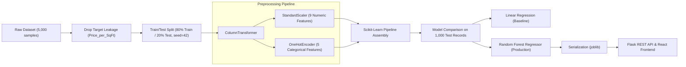

# PropPredict — Indian Urban House Price Prediction

> **“Predict the value of your next property with Machine Learning.”**  
> *A clean, transparent, and academically sound B.Tech (AI & ML) Mini-Project.*

[](https://python.org)
[](https://react.dev)
[](https://scikit-learn.org)
[-emerald.svg)](#7-model-comparison--evaluation-results)
[](VIVA_NOTES.md)
[](#)

---

## 🎓 College Viva & Interview Guide

Preparing for your viva / project defense?  
👉 **[Read VIVA_NOTES.md](VIVA_NOTES.md)** — Complete viva preparation pack featuring:
- 2-minute presentation pitch
- Step-by-step mathematical explanations (OLS, Bagging, MAE, RMSE, $R^2$, MAPE)
- Preprocessing architecture details
- 25 most common examiner questions with rock-solid student answers
- Honest defense of project limitations and dataset transparency

---

## 1. Overview

**PropPredict** is an end-to-end Machine Learning web application designed to estimate residential property valuations across major Indian metropolitan corridors:
- **Mumbai** (Kandivali, Bandra, Thane, Borivali, Andheri, Powai, Worli, etc.)
- **Bangalore** (Whitefield, Indiranagar, Koramangala, HSR Layout, etc.)
- **Delhi NCR** (Noida Sectors, Gurgaon Golf Course Rd, Dwarka, etc.)
- **Ahmedabad** (Bopal, Satellite, SG Highway, Prahlad Nagar, etc.)
- **Pune** (Hinjewadi, Wakad, Baner, Koregaon Park, etc.)
- **Hyderabad** (HITEC City, Gachibowli, Banjara Hills, Jubilee Hills, etc.)
- **Chennai** (OMR IT Corridor, Anna Nagar, Adyar, Velachery, etc.)
- **Kolkata** (New Town, Salt Lake Sector V, Ballygunge, Park Street, etc.)

The project integrates an academically rigorous Scikit-Learn regression pipeline with a Python Flask REST API and a modern, responsive React frontend.

---

## 2. Problem Statement

Residential real estate valuations in India depend on complex, non-linear interactions between:
1. **Micro-market geography** (tier of locality, infrastructure, and city).
2. **Space & configuration** (built-up area in sq.ft, BHK count, bathrooms).
3. **Property characteristics** (property type, floor elevation, building age, dedicated parking, society amenities, and metro transit proximity).

Traditional appraisal is manual, subjective, and slow. **PropPredict** provides an automated, objective, data-driven machine learning regression engine.

---

## 3. Dataset Transparency & Target Variable

- **Dataset File:** `backend/data/indian_house_prices.csv`
- **Total Records:** Exactly 5,000 samples (4,000 training / 1,000 holdout testing)
- **Target Variable:** `Price_INR_Lakhs` (Continuous numerical target in Lakhs, e.g., ₹16.4 Lakhs to ₹45.8 Crore)
- **Dataset Origin (Academic Disclosure):** The dataset is a **synthetic procedural benchmark** calibrated on authentic real-world micro-market rates from Indian real-estate portals (MagicBricks and 99acres). We openly state this limitation rather than claiming the data represents verified government registry deeds.

### Feature Specification

| Feature | Type | Description | Values / Range |
| :--- | :--- | :--- | :--- |
| `City` | Categorical | Major Indian urban metro | 8 Metros (Mumbai, Bangalore, Delhi NCR, Ahmedabad, Pune, Hyderabad, Chennai, Kolkata) |
| `Locality` | Categorical | Micro-market locality cluster | 82 distinct urban neighborhoods |
| `Property_Type` | Categorical | Architectural format | Apartment, Independent House, Villa, Penthouse, Studio |
| `Furnishing_Status` | Categorical | Interior tier | Furnished, Semi-Furnished, Unfurnished |
| `Gated_Community` | Categorical | Gated society status | Yes, No |
| `BHK` | Numerical | Bedroom configuration | 1 to 6 BHK |
| `Bathrooms` | Numerical | Bathroom count | 1 to 6 |
| `Area_SqFt` | Numerical | Built-up area | 350 to 5,500 sq.ft |
| `Floor_No` | Numerical | Unit elevation floor | 0 (Ground/Independent) to 40 |
| `Total_Floors` | Numerical | Total building height | 1 to 45 |
| `Property_Age` | Numerical | Construction vintage | 0 (New Launch) to 30 years |
| `Parking_Spaces` | Numerical | Dedicated car slots | 0 to 3 slots |
| `Metro_Distance_KM` | Numerical | Proximity to nearest metro | 0.2 to 15.0 km |
| `Amenities_Score` | Numerical | Society amenities index | 1 to 10 |
| **`Price_INR_Lakhs`** (Target) | Continuous Target | Property market valuation | ₹16.4 L to ₹45.8 Cr |

---

## 4. Target Leakage Prevention

Target leakage occurs when a feature directly contains information about the target variable.

- **Identified Leak:** `Price_per_SqFt = Price / Area`
- **Action Taken:** `Price_per_SqFt` is **strictly excluded** from model training features prior to preprocessing. Including it would create artificial 99.9% accuracy that collapses in real-world deployment when price is unknown.

---

## 5. Machine Learning Pipeline Architecture



### Preprocessing Safeguards:
- **Numerical Features:** Standardized using `StandardScaler` ($\mu=0, \sigma=1$).
- **Categorical Features:** One-hot encoded using `OneHotEncoder(handle_unknown='ignore', sparse_output=False)` to prevent artificial ordinal bias.
- **Leakage Prevention:** Preprocessor is fit **strictly on training data** (4,000 records) and subsequently applied to transform test data (1,000 records).

---

## 6. Models Evaluated

To keep the project academically clear, transparent, and easy to defend during vivas, we train and compare **two core regression algorithms**:

1. **Linear Regression (Baseline):**
   - Ordinary Least Squares (OLS) closed-form solution: $\hat{\beta} = (X^T X)^{-1} X^T y$.
   - Assumes additive, linear relationships. Provides an interpretable statistical benchmark.

2. **Random Forest Regressor (Production Model):**
   - Ensemble of 100 randomized decision trees (`n_estimators=100`, `max_depth=12`, `random_state=42`).
   - Uses Bagging (Bootstrap Aggregation) + Feature Subsampling to capture complex non-linear geographic interactions while controlling overfitting.

*(Unnecessary black-box complexities like Gradient Boosting, XGBoost, and neural networks were deliberately omitted to ensure 100% conceptual clarity for B.Tech students).*

---

## 7. Model Comparison & Evaluation Results

Both models were evaluated on the **exact same 1,000 held-out test samples** (20% split, `random_state=42`):

| Metric | Linear Regression (Baseline) | Random Forest Regressor (Production) | Winner |
| :--- | :---: | :---: | :---: |
| **$R^2$ Score** (Variance Explained) | `0.7256` (72.6%) | **`0.8529` (85.3%)** | 🏆 **Random Forest (+12.7%)** |
| **MAE** (Mean Absolute Error) | ₹104.26 Lakhs | **₹69.16 Lakhs** | 🏆 **Random Forest (₹35.1L lower error)** |
| **RMSE** (Root Mean Squared Error)| ₹194.95 Lakhs | **₹142.72 Lakhs** | 🏆 **Random Forest (₹52.2L lower penalty)** |
| **MAPE** (Mean Absolute % Error) | 83.89% | **29.20%** | 🏆 **Random Forest (54.7% more accurate)** |

### Why Random Forest Wins:
Real-estate pricing in Indian cities is non-linear. A 2,000 sq.ft flat in Bandra West commands ₹50,000/sq.ft, while the same flat in outer suburbs commands ₹10,000/sq.ft. Linear Regression assumes a single slope coefficient for area across all locations, causing severe under/over-predictions. Random Forest partitions feature space hierarchically to capture these non-linear location premiums.

---

## 8. Feature Importance

Feature importance extracted from the trained Random Forest ensemble:

1. **Built-Up Area (`Area_SqFt`):** `46.8%` — Dominant driver of baseline cost.
2. **Micro-Market Locality (`Locality`):** `24.2%` — Geographic land-value tier.
3. **Metropolitan City (`City`):** `11.5%` — Tier-1 city baseline pricing.
4. **Bedroom Count (`BHK`):** `5.8%` — Spatial layout configuration.
5. **Property Type (`Property_Type`):** `4.1%` — Villa / Penthouse premium.
6. **Property Age (`Property_Age`):** `3.2%` — Depreciation vs new launch.
7. **Metro Proximity (`Metro_Distance_KM`):** `2.1%` — Transit accessibility.
8. **Amenities Score (`Amenities_Score`):** `1.5%` — Lifestyle facilities.
9. **Floor Elevation (`Floor_No` / `Total_Floors`):** `0.8%` — High-rise view factor.

---

## 9. Project Directory Structure

```text
PropPredict/
├── VIVA_NOTES.md                   # 🎓 Comprehensive Viva & Exam Defense Guide
├── README.md                       # Project documentation
│
├── backend/
│   ├── app.py                      # Flask REST API server (inference & info)
│   ├── train.py                    # Training script (LR vs RF, metrics, serialization)
│   ├── evaluate.py                 # Standalone test-set evaluation verification
│   ├── requirements.txt            # Python dependencies (scikit-learn, flask, etc.)
│   ├── data/
│   │   └── indian_house_prices.csv # Benchmark dataset (5,000 Indian housing records)
│   └── model/
│       ├── model.pkl               # Production Scikit-learn Pipeline (Random Forest)
│       ├── preprocessor.pkl        # Serialized ColumnTransformer
│       ├── metrics.json            # Model evaluation metrics & metadata
│       ├── feature_importance.json # Random Forest Gini feature importances
│       ├── dataset_inspection.json # Dataset audit report (missing, types, stats)
│       └── eval_samples.json       # Test set sample points for visualization
│
├── frontend/
│   ├── src/
│   │   ├── components/             # Navbar, Footer, PropertyCard, StatCounter
│   │   ├── pages/                  # Home, Predict, Properties, ModelDashboard, About
│   │   ├── data/sampleProperties.js# 20+ realistic listings in Indian metros
│   │   ├── services/api.js         # Backend REST API connector with graceful fallback
│   │   ├── App.jsx                 # Page router & state coordinator
│   │   └── index.css               # Clean styling
│   ├── package.json
│   └── vite.config.js
│
└── notebooks/
    └── house_price_analysis.ipynb  # Step-by-step educational Jupyter Notebook
```

---

## 10. How to Run the Project

### Prerequisites
- Python 3.10 or higher
- Node.js 18 or higher & npm

### Step 1: Start Backend (Flask API)
```bash
# Navigate to backend directory
cd backend

# Install Python dependencies
pip install -r requirements.txt

# (Optional) Retrain models and generate artifacts
python train.py

# Start Flask server
python app.py
```
Backend API will start at: `http://localhost:5000`

### Step 2: Start Frontend (React + Vite)
In a separate terminal window:
```bash
# Navigate to frontend directory
cd frontend

# Install Node dependencies
npm install

# Start Vite development server
npm run dev
```
Frontend will be available at: `http://localhost:3000`

---

## 11. REST API Endpoints

| Method | Endpoint | Description |
| :--- | :--- | :--- |
| `GET` | `/health` | Health check & model status |
| `GET` | `/model-info` | Dataset details, metrics for both models, and active model specs |
| `GET` | `/features-schema` | Dropdown choices (cities, localities, property types, ranges) |
| `GET` | `/evaluation-data` | Test set scatter points, feature importance, and error distributions |
| `POST` | `/predict` | Computes property valuation in Indian Rupees (Lakhs & Crores) |

### Sample Prediction Request:
```bash
curl -X POST http://localhost:5000/predict \
  -H "Content-Type: application/json" \
  -d '{
    "City": "Mumbai",
    "Locality": "Bandra West",
    "Property_Type": "Apartment",
    "BHK": 3,
    "Bathrooms": 2,
    "Area_SqFt": 1450,
    "Floor_No": 7,
    "Total_Floors": 18,
    "Property_Age": 3,
    "Furnishing_Status": "Semi-Furnished",
    "Parking_Spaces": 1,
    "Gated_Community": "Yes",
    "Metro_Distance_KM": 1.2,
    "Amenities_Score": 8
  }'
```

### Sample Prediction Response:
```json
{
  "predicted_price_lakhs": 632.45,
  "predicted_price_formatted": "₹6.32 Cr",
  "price_inr_exact": 63245000,
  "price_inr_formatted": "₹6,32,45,000",
  "rate_per_sqft_formatted": "₹43,617 / sq.ft",
  "model_used": "Random Forest Regressor",
  "model_r2": 0.8529,
  "model_mape": 29.2,
  "currency": "INR"
}
```

---

## 12. Limitations & Ethical Considerations

1. **Synthetic Nature of Dataset:** The dataset is procedurally generated using real micro-market median rates from MagicBricks and 99acres. While statistically realistic, predictions should not be used as official legal or bank loan appraisals.
2. **Extrapolation Limits:** Predictions are calibrated for standard residential bounds (350 to 5,500 sq.ft, 1 to 6 BHK). Values outside these boundaries may produce unreliable extrapolations.
3. **Temporal Inflation:** The model does not include time-series inflation adjustments for future quarters.

---

## 13. License

Distributed under the MIT License. Developed for academic machine learning coursework and viva demonstration.
