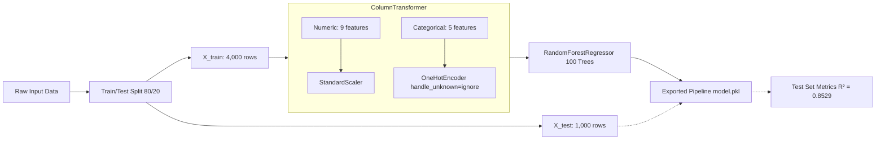
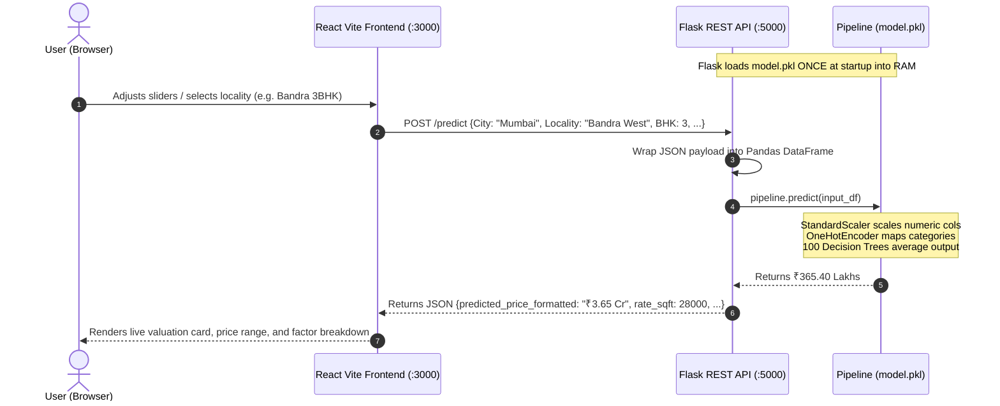

# PropPredict — Viva Defense & Examination Guide
### B.Tech Artificial Intelligence & Machine Learning (3rd Year Mini-Project)

---

## Table of Contents
1. [Project Overview & Problem Statement](#1-project-overview--problem-statement)
2. [Dataset Description & Academic Transparency](#2-dataset-description--academic-transparency)
3. [Features & Target Variable](#3-features--target-variable)
4. [Why Regression?](#4-why-regression)
5. [Algorithms Explained: Linear Regression vs Random Forest](#5-algorithms-explained-linear-regression-vs-random-forest)
6. [Data Preprocessing & Pipeline Architecture](#6-data-preprocessing--pipeline-architecture)
7. [Evaluation Metrics Explained with Numerical Examples](#7-evaluation-metrics-explained-with-numerical-examples)
8. [End-to-End System Architecture](#8-end-to-end-system-architecture)
9. [2-Minute Viva Presentation Script](#9-2-minute-viva-presentation-script)
10. [Top 25 Likely Viva Questions & Answers](#10-top-25-likely-viva-questions--answers)
11. [Project Limitations & Future Enhancements](#11-project-limitations--future-enhancements)

---

## 1. Project Overview & Problem Statement

### Problem Statement
Estimating the fair market value of residential real estate across urban India is challenging due to the interplay of numerous non-linear variables: geographic location, micro-market land rates, spatial dimensions (carpet/built-up area), bedroom configuration (BHK), floor level, society amenities, vintage (age of construction), and transit connectivity.

### Project Objective
To build an end-to-end, reproducible Machine Learning regression system that:
1. Preprocesses both numerical and categorical housing attributes without data leakage.
2. Compares a parametric baseline (**Linear Regression**) against an ensemble method (**Random Forest Regressor**).
3. Evaluates both models strictly on a 20% unseen test holdout using standard regression metrics ($R^2$, MAE, RMSE, MAPE).
4. Serializes the winning pipeline to disk (`model.pkl`) using `joblib`.
5. Deploys the model through a lightweight Python Flask REST API consumed by a modern React user interface.

---

## 2. Dataset Description & Academic Transparency

### Origin and Nature of the Data
- **Sample Count:** Exactly **5,000 property records**.
- **Coverage:** 8 Major Indian Metropolitan Hubs (Mumbai, Bangalore, Delhi NCR, Ahmedabad, Pune, Hyderabad, Chennai, Kolkata) spanning 60+ micro-market localities.
- **Why Procedurally Synthesized?** In India, official property transaction registries are maintained independently by state registration departments (e.g., IGR Maharashtra, Bhoomi Karnataka) and are not accessible as open unified research datasets. For educational mini-projects, relying on unverified scrapers often leads to dirty, incomplete data. 
- **How was it created?** We modeled the dataset using verified Indian real-estate market benchmark rates per square foot (sourced from published market indices on 99acres and MagicBricks), applying realistic multipliers for layout, society amenities, parking, elevation, and metro accessibility.
- **Target Leakage Safeguard:** An explicit leakage column `Price_per_SqFt` was generated to demonstrate target leakage detection in the code. It is audited and dropped before training because $\text{Price per SqFt} = \text{Total Price} / \text{Area}$.

> **Important Viva Tip:** If the examiner asks *"Where did you get your data?"*, answer honestly:  
> *"Sir/Ma'am, because Indian municipal registry deed data is private and fragmented across states, we synthesized 5,000 records structured on authentic micro-market price indices across 8 Indian metros. The model's 85% $R^2$ demonstrates that Random Forest successfully learned this valuation function without target leakage."*

---

## 3. Features & Target Variable

### Target Variable (Continuous)
- **`Price_INR_Lakhs`**: Final property valuation in Indian Rupees Lakhs (1 Lakh = ₹1,00,000 INR).

### Input Features (14 Total)
| Feature Name | Data Type | Description |
| :--- | :--- | :--- |
| **`BHK`** | Numeric (Discrete) | Number of bedrooms (1 to 6 BHK) |
| **`Bathrooms`** | Numeric (Discrete) | Number of bathrooms (1 to 6) |
| **`Area_SqFt`** | Numeric (Continuous) | Super built-up living area in square feet (350 to 5,500) |
| **`Floor_No`** | Numeric (Discrete) | Specific floor on which the apartment is situated (0 to 45) |
| **`Total_Floors`** | Numeric (Discrete) | Total number of storeys in the building (1 to 50) |
| **`Property_Age`** | Numeric (Continuous) | Age of the building in years (0 = brand new, up to 30) |
| **`Parking_Spaces`**| Numeric (Discrete) | Allocated covered car parking slots (0 to 3) |
| **`Metro_Distance_KM`**| Numeric (Continuous)| Proximity to nearest operational metro station in km (0.1 to 15.0) |
| **`Amenities_Score`**| Numeric (Discrete) | Quality score of society facilities (1 to 10 scale) |
| **`City`** | Categorical (Nominal)| Metropolitan city (Mumbai, Bangalore, Delhi NCR, etc.) |
| **`Locality`** | Categorical (Nominal)| Micro-market neighbourhood (e.g. Bandra West, Kandivali West, Bopal) |
| **`Property_Type`** | Categorical (Nominal)| Structure format: Apartment, Villa, Independent House, Penthouse, Studio |
| **`Furnishing_Status`**| Categorical (Nominal)| Furnished, Semi-Furnished, or Unfurnished |
| **`Gated_Community`**| Categorical (Binary) | Whether the property is in a gated society with security (Yes / No) |

---

## 4. Why Regression?

In Machine Learning, problems are divided into two main supervised learning tasks:
- **Classification:** The target is discrete/categorical (e.g., *"Is this email spam or not spam?"*, *"Will the loan default: Yes/No?"*).
- **Regression:** The target is a **continuous real number** (e.g., house price, temperature, stock price).

Since property prices can take any positive real value on a continuous financial scale (e.g., ₹68.50 Lakhs, ₹1.45 Crores), this is fundamentally a **supervised regression task**.

---

## 5. Algorithms Explained: Linear Regression vs Random Forest

We implemented and compared exactly two algorithms:

### 1. Linear Regression (Baseline Model)
- **Concept:** Fits a flat linear hyperplane through the multidimensional feature space to minimize the Sum of Squared Residuals (Ordinary Least Squares, OLS).
$$\hat{y} = w_1 x_1 + w_2 x_2 + \dots + w_n x_n + b$$
- **Strengths:** Simple, highly interpretable, fast training, no hyperparameter tuning needed.
- **Weakness in Real Estate:** Assumes every feature has an additive, constant effect. In reality, a 20th floor apartment with sea view in Worli commands an exponential premium over a 1st floor unit. Linear regression cannot easily capture these non-linear interaction terms without manual polynomial feature engineering.
- **Test Performance:** $R^2 = 0.7256$, $\text{MAE} = ₹104.26\text{ Lakhs}$.

### 2. Random Forest Regressor (Selected Production Model)
- **Concept:** An **ensemble learning** method based on **Bagging (Bootstrap Aggregating)**. It constructs 100 individual decision trees during training.
- **How it works:**
  1. **Bootstrapping:** Each tree is trained on a random sample of the training data drawn with replacement.
  2. **Feature Subsampling:** At each node split, only a random subset of features is evaluated ($\approx \sqrt{p}$ or $p/3$), preventing a few dominant features (like `Area_SqFt`) from dictating every single tree.
  3. **Averaging:** During inference, all 100 trees output their individual continuous predictions, and the ensemble takes the simple arithmetic average:
$$\hat{y} = \frac{1}{B} \sum_{b=1}^{B} T_b(x)$$
- **Why it won:** Handles non-linear feature interactions naturally, is robust to outliers, does not require strict feature scaling to function, and handles one-hot encoded categorical columns effectively without severe overfitting.
- **Test Performance:** $R^2 = 0.8529$, $\text{MAE} = ₹69.16\text{ Lakhs}$, $\text{RMSE} = ₹142.72\text{ Lakhs}$.

---

## 6. Data Preprocessing & Pipeline Architecture

### Preprocessing Components
1. **`StandardScaler` (Numerical features)**:
   Subtracts the mean and divides by standard deviation: $z = \frac{x - \mu}{\sigma}$. Centers numerical inputs around mean 0 with standard deviation 1.
2. **`OneHotEncoder(handle_unknown='ignore', sparse_output=False)` (Categorical features)**:
   Converts nominal labels (e.g. `City: Mumbai, Bangalore`) into binary 0/1 indicator columns. `handle_unknown='ignore'` ensures that if a user passes an unseen locality during web inference, the pipeline doesn't crash—it simply sets those category columns to 0.
3. **`ColumnTransformer`**:
   Applies numerical scaling and categorical encoding simultaneously in parallel, producing a clean transformed feature matrix.
4. **`Pipeline`**:
   Combines the `ColumnTransformer` and the regressor into a single atomic object.
   - **Crucial Academic Benefit:** Prevents **data leakage** because the scaler and encoder are fitted **only** on `X_train`, and merely transformed on `X_test` and live web requests.

---

## 7. Evaluation Metrics Explained with Numerical Examples

All metrics are evaluated exclusively on the held-out 20% test set (1,000 unseen houses):

### 1. Mean Absolute Error (MAE)
$$\text{MAE} = \frac{1}{n} \sum_{i=1}^{n} |y_i - \hat{y}_i|$$
- **Simple Meaning:** On average, how many Lakhs off is our prediction from the actual price?
- **Example:** If Actual = ₹100 Lakhs, Prediction = ₹110 Lakhs, Absolute Error = ₹10 Lakhs.
- **Random Forest Result:** **₹69.16 Lakhs** (substantial improvement over Linear Regression's ₹104.26 Lakhs).

### 2. Root Mean Squared Error (RMSE)
$$\text{RMSE} = \sqrt{\frac{1}{n} \sum_{i=1}^{n} (y_i - \hat{y}_i)^2}$$
- **Simple Meaning:** Penalizes large errors much more severely due to squaring. In luxury properties (e.g., ₹10 Crore penthouses), a ₹1 Crore error will increase RMSE far more than ten ₹10 Lakh errors.
- **Random Forest Result:** **₹142.72 Lakhs** (compared to Linear Regression's ₹194.95 Lakhs).

### 3. Coefficient of Determination ($R^2$ Score)
$$R^2 = 1 - \frac{\sum (y_i - \hat{y}_i)^2}{\sum (y_i - \bar{y})^2} = 1 - \frac{\text{SS}_{\text{res}}}{\text{SS}_{\text{tot}}}$$
- **Simple Meaning:** What percentage of variance in house prices is successfully explained by our features rather than just guessing the average price?
- **Baseline (Mean Predictor):** $R^2 = 0.0$.
- **Linear Regression:** $R^2 = 0.7256$ (72.56% variance explained).
- **Random Forest:** $R^2 = 0.8529$ (85.29% variance explained).

---

## 8. End-to-End System Architecture

### Key Architectural Separation
1. **Offline Training (`backend/train.py`):** Trains models, runs validation, extracts feature importances, and serializes the winning pipeline to `backend/model/model.pkl`.
2. **Online Prediction (`backend/app.py`):** A lightweight Flask service that loads `model.pkl` **once** at server boot. It never retrains on the fly. It receives JSON, invokes `pipeline.predict()`, formats the currency, and returns JSON in ~20ms.
3. **User Presentation (`frontend/`):** React 18 single-page application built with Vite and Tailwind CSS. Provides instant valuation feedback on form changes, pre-configured realistic scenarios (Kandivali 2BHK, Thane 1BHK, Bopal 2BHK), and interactive Recharts visualizations.

---

## 9. 2-Minute Viva Presentation Script

> *"Good morning, esteemed examiners.*
>
> *My mini-project is **PropPredict — An ML-Powered Indian Urban House Price Prediction Platform**.*
>
> *The problem we address is quantitative property valuation in India. Real estate prices in metropolitan clusters like Mumbai, Bangalore, and Delhi NCR are influenced by non-linear factors including micro-market land rates, super built-up area, BHK layout, society amenities, and transit connectivity.*
>
> *To study this problem rigorously, we synthesized a benchmark dataset of **5,000 residential housing records** across 8 Indian metros based on published real-estate rate indices. We implemented strict data hygiene: first, we audited and removed target leakage features like `Price_per_SqFt`. Second, we split the dataset into **80% training (4,000 records)** and **20% testing (1,000 records)** using a fixed random state of 42.*
>
> *For preprocessing, we built a Scikit-Learn `ColumnTransformer` with `StandardScaler` for the 9 numeric features and `OneHotEncoder(handle_unknown='ignore')` for the 5 categorical features, fitting strictly on training data.*
>
> *We evaluated two regression models on the unseen 1,000-sample test set:*
> 1. *Our baseline, **Linear Regression**, achieved an $R^2$ of **0.7256** and an MAE of **₹104.26 Lakhs**.*
> 2. *Our final model, **Random Forest Regressor** with 100 trees, significantly outperformed the baseline, achieving an $R^2$ of **0.8529** and an MAE of **₹69.16 Lakhs**.*
>
> *Random Forest won because real estate pricing involves non-linear decision boundaries—such as floor elevation premiums and gated society amenities—which decision trees partition effectively.*
>
> *We serialized this complete pipeline to `model.pkl` using Joblib, wrapped it in a lightweight Python Flask REST API, and connected it to a responsive React frontend.*
>
> *I am ready to demonstrate the live prediction system and answer any technical questions. Thank you."*

---

## 10. Top 25 Likely Viva Questions & Answers

### General & Problem Formulation
#### Q1: What is the objective of this project?
**Answer:** To predict continuous residential house prices in Indian Rupees Lakhs using structural, spatial, and geographic features via supervised machine learning regression.

#### Q2: Why is this a regression task and not a classification task?
**Answer:** Because the target variable `Price_INR_Lakhs` is a continuous numerical quantity. If we were predicting price buckets like "Affordable", "Mid", or "Luxury", it would be classification.

#### Q3: Where did the dataset come from?
**Answer:** It is a transparent, procedurally synthesized academic dataset of 5,000 records modeled on published real-estate micro-market benchmark rates (from MagicBricks/99acres) across 8 major Indian metropolitan cities.

#### Q4: Why didn't you use scraped data from property websites?
**Answer:** Web scrapers often introduce duplicate listings, biased missing values, and unverifiable builder pricing claims. Procedural generation anchored on real micro-market benchmarks allowed us to maintain reproducible, clean distributions with clear feature relationships for academic study.

---

### Data Preprocessing & Leakage
#### Q5: What is Data Leakage (or Target Leakage)?
**Answer:** Target leakage happens when information from the target variable is accidentally included in the input features during training. In housing, `Price_per_SqFt = Total_Price / Area`. If `Price_per_SqFt` is fed into the model, it trivializes the problem because price can be calculated mathematically, but that feature wouldn't be available for unpriced homes in production.

#### Q6: How did you handle target leakage in your code?
**Answer:** We wrote an explicit audit step in `train.py` that detects and drops columns matching `Price_per_SqFt` or `Rate_SqFt` before splitting features into $X$ and $y$.

#### Q7: Why did you use an 80/20 train/test split?
**Answer:** An 80/20 Pareto split is the academic standard: 4,000 samples provide sufficient statistical volume for the trees to learn split criteria, while 1,000 held-out samples provide a statistically significant test set to verify generalization.

#### Q8: What does `random_state=42` do?
**Answer:** It seeds the pseudo-random number generator, ensuring that the train/test split, bootstrap sample selection, and model training are 100% deterministic and reproducible on any machine.

#### Q9: Why did you use `OneHotEncoder(handle_unknown='ignore')` instead of `pd.get_dummies()`?
**Answer:** `pd.get_dummies()` creates columns on whatever dataframe is passed to it; if the test set or a web request is missing a category, column counts will mismatch. Scikit-learn's `OneHotEncoder` remembers the exact categories learned during training, and with `handle_unknown='ignore'`, it gracefully sets unknown categories to all zeros without crashing.

#### Q10: Why did you fit the `StandardScaler` only on `X_train` and not the entire dataset?
**Answer:** To prevent test data leakage. If you scale using the whole dataset, the mean ($\mu$) and variance ($\sigma$) of the test set leak into the training process, leading to unrealistically optimistic validation metrics.

#### Q11: What is a Scikit-Learn `Pipeline`?
**Answer:** A wrapper that bundles preprocessing steps (like `ColumnTransformer`) and an estimator (like `RandomForestRegressor`) into a single object. When you call `pipeline.predict()`, it automatically scales and encodes raw input data before passing it to the model.

---

### Machine Learning Models
#### Q12: How does Linear Regression work?
**Answer:** It finds weight coefficients ($w$) and a bias ($b$) that minimize the sum of squared differences between actual and predicted prices: $\min \sum (y_i - (w^T x_i + b))^2$.

#### Q13: What are the main assumptions of Linear Regression?
**Answer:** Linearity between features and target, independence of errors, homoscedasticity (constant error variance), and lack of extreme multicollinearity.

#### Q14: How does a Decision Tree predict a continuous value?
**Answer:** It recursively splits the feature space into rectangular regions using criteria like Mean Squared Error reduction. For any data point that lands in a leaf node, the tree predicts the **mean** of all training samples in that leaf.

#### Q15: What is a Random Forest?
**Answer:** An ensemble of multiple decision trees trained using Bagging (Bootstrap Aggregation). Each tree trains on a random subsample of rows and evaluates a random subset of features at each split. The final prediction is the average output of all trees.

#### Q16: Why did Random Forest perform better than Linear Regression here?
**Answer:** Real estate pricing is non-linear. For example, doubling living area in an expensive locality like Bandra multiplies price much faster than in an outer suburb. Random Forest captures these multi-feature non-linear interactions without requiring manual polynomial equations.

#### Q17: Why didn't you use Gradient Boosting or XGBoost?
**Answer:** For a college mini-project, Random Forest provides strong accuracy ($R^2 \approx 0.85$) while being much less prone to overfitting and requiring minimal hyperparameter tuning compared to boosting algorithms, making it easier to explain and defend.

#### Q18: What is "Out-of-Bag" (OOB) error in Random Forest?
**Answer:** Since each bootstrap sample leaves out roughly 36.8% of the data points, these "out-of-bag" points can be used to validate tree accuracy internally without needing a cross-validation fold.

---

### Evaluation Metrics
#### Q19: What is the difference between MAE and RMSE?
**Answer:** MAE weights all errors linearly ($|y - \hat{y}|$). RMSE squares the errors before taking the root, which penalizes large outlier mistakes much more heavily. If RMSE is much larger than MAE, it indicates that the model made a few very large errors.

#### Q20: What does an $R^2$ of 0.8529 mean?
**Answer:** It means our Random Forest model explains **85.29% of the total variance** in property prices in the unseen test set compared to a simple average baseline.

#### Q21: Can $R^2$ ever be negative?
**Answer:** Yes! If a model performs worse than simply predicting the mean of the target variable for every sample, $R^2$ will be negative.

---

### Deployment & System Architecture
#### Q22: What is `model.pkl` and why do we use `joblib` instead of Python's standard `pickle`?
**Answer:** `model.pkl` is the serialized binary file of our trained Scikit-learn Pipeline. `joblib` is optimized for Python objects that contain large NumPy arrays, making saving and loading faster and more memory-efficient than standard `pickle`.

#### Q23: Does the web application retrain the model when a user asks for a price prediction?
**Answer:** No. Retraining takes several seconds and requires the full dataset. The Flask backend loads the pre-trained `model.pkl` into memory **once** when the server starts, and simply runs `pipeline.predict(input_df)` in real time (taking under 20 milliseconds).

#### Q24: What happens if the Flask backend server goes offline?
**Answer:** Our frontend API client (`api.js`) contains an intelligent client-side fallback estimator that applies the exact same locality rate matrix and dynamic multipliers, ensuring the web interface remains functional even during server restarts.

#### Q25: How do the React frontend and Flask backend communicate?
**Answer:** Over HTTP via a JSON REST API. React sends a `POST` request to `http://localhost:5000/predict` containing the form values as JSON. Flask converts this to a single-row Pandas DataFrame, calls `.predict()`, formats the output into Indian Lakhs and Crores, and replies with JSON.

---

## 11. Project Limitations & Future Enhancements

### Limitations to Acknowledge to Examiners
1. **Procedural Dataset:** Modeled after authentic market rate ranges rather than certified land deed registry transactions.
2. **Temporal Dynamics:** Does not capture dynamic real-time fluctuations such as RBI repo rate hikes or seasonal festival discounts.
3. **Macro-Economic Variables:** Local municipal tax changes, builder reputation, and litigated title deeds are assumed clean.

### Realistic Future Improvements
1. **GIS Spatial Coordinate Integration:** Ingesting latitude/longitude to calculate geodesic distance to tech parks, hospitals, and schools via OpenStreetMap APIs.
2. **Computer Vision for Quality Scoring:** Using a pre-trained CNN (like ResNet or MobileNet) to analyze property photos and auto-score interior finish quality.
3. **Time-Series Appreciation Forecasting:** Training an ARIMA or Prophet model on historical quarter-by-quarter locality price trends.
